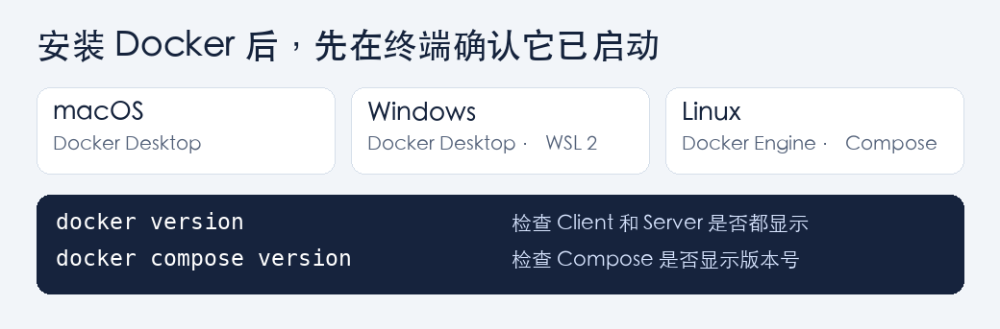
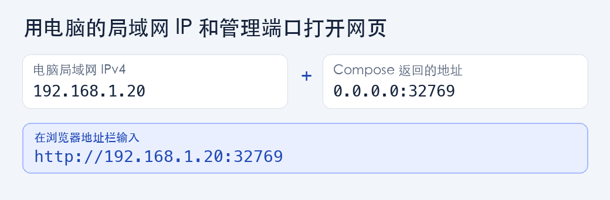
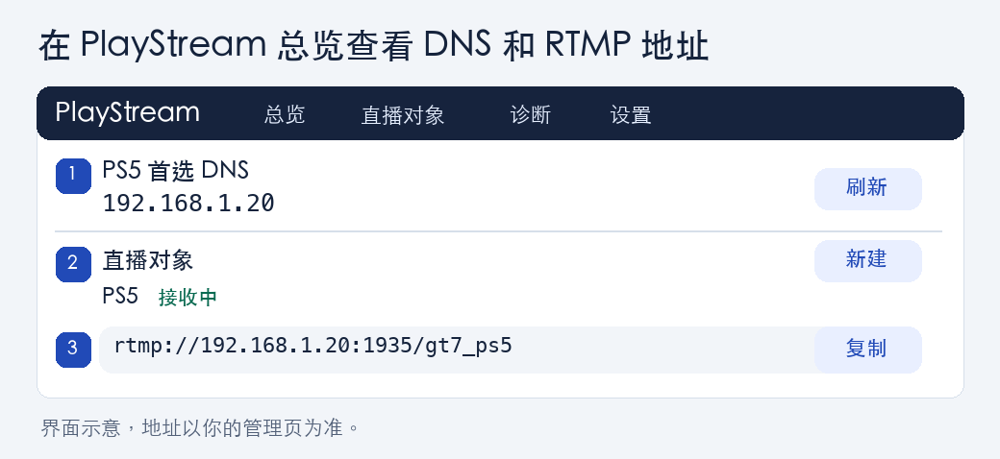
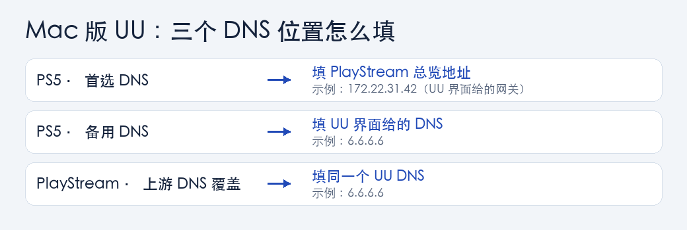
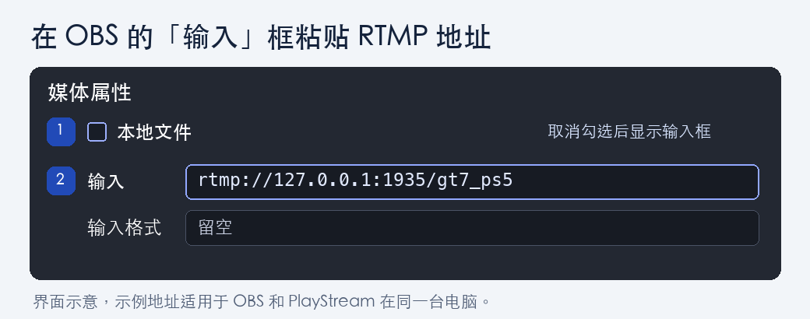

# PlayStream 图文部署教程

从安装 Docker 到在 OBS 里看到 PS5 画面。你需要一台 PS5、一台和它在同一局域网的电脑，以及已启用两步验证并绑定到 PlayStation 的 Twitch 账号。电脑上安装 Docker 和 OBS 即可开始，使用 UU 方案时另装 Mac 版 UU。Go 和 MediaMTX 由 Docker 处理。[PlayStation 开播指南](https://www.playstation.com/en-us/support/games/ps5-stream-gameplay-broadcast/) · [Twitch 账号要求](https://www.playstation.com/en-us/support/games/ps4-broadcast-and-share-play-troubleshooting/)

## 1. 安装并启动 Docker



**macOS**

1. 点屏幕左上角 ** → 关于本机**。显示 Apple 芯片（例如 M1、M2）就下载 Apple silicon 版，显示 Intel 处理器就下载 Intel 版。[Docker Desktop for Mac 官方下载与安装](https://docs.docker.com/desktop/setup/install/mac-install/)
2. 打开下载的 `Docker.dmg`，把 Docker 拖到「应用程序」，再从「应用程序」打开 Docker Desktop。完成首次设置，等待 Docker 引擎启动。
3. PlayStream 要让 PS5 从局域网访问 DNS 的 `53` 端口。新版 Docker Desktop 在 **Settings → Advanced** 勾选 **Allow privileged port forwarding to external machines** 并应用。如果旧版在安装时提供 **Enable privileged port mapping**，启用该项。[Docker Desktop 低端口说明](https://docs.docker.com/desktop/setup/install/mac-permission-requirements/#binding-privileged-ports)

**Windows**

1. 在「设置 → 系统 → 系统信息」查看「系统类型」，从官方页面下载匹配的安装包。多数 PC 选择 `x86_64`，ARM 电脑选择 Arm 版。[Docker Desktop for Windows 官方下载与安装](https://docs.docker.com/desktop/setup/install/windows-install/)
2. 在 PowerShell 运行 `wsl --version`。如果 WSL 未安装，用管理员 PowerShell 执行 `wsl --install`，按提示重启。已有 WSL 但版本过旧时执行 `wsl --update`。[Microsoft WSL 安装指南](https://learn.microsoft.com/windows/wsl/install)
3. 运行 `Docker Desktop Installer.exe`，使用 WSL 2 后端。安装后从开始菜单打开 Docker Desktop，等待引擎就绪。PlayStream 使用 Linux 容器；如果 Docker 托盘菜单显示 **Switch to Linux containers…**，点击切换。[Docker Desktop 的容器模式](https://docs.docker.com/desktop/setup/install/windows-install/#windows-containers)

**Linux**

1. 打开 [Docker Engine 安装页](https://docs.docker.com/engine/install/)，点自己的发行版，按页面步骤添加 Docker 官方软件源。以 Ubuntu 为例，按[官方 Ubuntu 指南](https://docs.docker.com/engine/install/ubuntu/#install-using-the-apt-repository)添加 APT 源后运行：

   ```bash
   sudo apt update
   sudo apt install docker-ce docker-ce-cli containerd.io docker-buildx-plugin docker-compose-plugin
   sudo systemctl enable --now docker
   ```

2. 其他发行版按对应页面安装 Docker Engine、Buildx 和 Compose 插件。下面的 Docker 命令如果遇到访问 Docker socket 的权限错误，可用 `sudo docker ...` 运行。[Compose 插件安装说明](https://docs.docker.com/compose/install/linux/) · [Docker Engine 安装后设置](https://docs.docker.com/engine/install/linux-postinstall/)

**安装完成后**，在 macOS「终端」、Windows PowerShell 或 Linux 终端执行：

```text
docker version
docker compose version
```

第一条应显示 `Client` 和 `Server` 两部分，第二条应显示 Compose 版本。如果第一条只有 `Client` 并提示无法连接，先打开 Docker Desktop 或启动 Docker 服务，再重试。

## 2. 下载 PlayStream 并启动

1. 登录有访问权限的 GitHub 账号，打开 [LanRaw/PlayStream](https://github.com/LanRaw/PlayStream)，点击 **Code → Download ZIP**。解压后找到包含 `compose.yaml`、`Dockerfile` 和 `.env.example` 的文件夹，通常叫 `PlayStream-main`。下载 ZIP 可以跳过安装 Git。[GitHub 源码下载说明](https://docs.github.com/en/repositories/working-with-files/using-files/downloading-source-code-archives#downloading-source-code-archives-from-the-repository-view)
2. 在终端用 `cd` 进入这个文件夹。下面以解压到「下载」目录为例。第一次部署运行 `cp` 或 `Copy-Item` 创建 `.env`，以后再启动时跳过复制，保留已有配置。

   macOS / Linux：

   ```bash
   cd "$HOME/Downloads/PlayStream-main"
   cp .env.example .env
   docker compose up -d --build
   docker compose port playstream 8080
   ```

   Windows PowerShell：

   ```powershell
   Set-Location "$HOME\Downloads\PlayStream-main"
   Copy-Item .env.example .env
   docker compose up -d --build
   docker compose port playstream 8080
   ```

3. `up` 会下载 Docker Hub 的基础镜像和 Go 模块、构建镜像并在后台启动。最后一条命令会显示管理端口，例如 `0.0.0.0:32769`。实际端口以你电脑显示的为准。[Docker Compose 启动命令](https://docs.docker.com/reference/cli/docker/compose/up/)
4. 找到电脑的**局域网 IPv4**。macOS 在「系统设置 → 网络 → 当前网络 → 详细信息 → TCP/IP」看 IPv4 地址，Windows 运行 `ipconfig` 看当前 Wi-Fi 或以太网的 IPv4，Linux 运行 `ip -4 addr` 看正在联网的网卡地址。用这个 IP 加上管理端口在浏览器打开。示例 `http://192.168.1.20:32769`。如果稍后改用 Mac 版 UU，第 4 步会用到同一个管理端口。



## 3. 登录并新建直播对象

1. 浏览器弹出登录框时，输入用户名 **`driver`**，默认密码 **`gt1234567`**。密码可在项目目录的 `.env` 中修改，修改后重新运行 `docker compose up -d`。
2. 在 PlayStream 打开 **直播对象 → 新建**。「显示名称」填 `PS5`，「固定别名」填 `gt7_ps5`。勾选「启用」，点「保存」。固定别名是 RTMP 地址的最后一段，使用英文字母、数字、下划线或短横线。
3. 回到 **总览**，确认对象是「就绪」。如果有多个对象，可以在「直播对象」中点对应卡片的「切换」，下次开播就会使用它。



## 4. 设置 PS5 的网络

先用 PS5 原有的网络设置验证能否开启 Twitch 直播，验证后停播。能正常开播就用 **直连**。如果连 Twitch 开播界面都打不开，且 Mac 版 UU 主机加速可以让它开播，就用 **Mac 版 UU**。已实测 Mac 版 UU 可以在关闭 Clash 时工作。电脑和 PS5 要保持在同一个局域网，建议连接同一台路由器的普通 Wi-Fi 或网线。

在 PS5 打开 **设置 → 网络 → 设定互联网连接**，选中当前网络，按手柄 **Options** 键进入「高级设置」。根据选中的方案填下表。若从 UU 切回直连，也在这里恢复原有的 IP、掩码和网关。[PlayStation 网络设置指南](https://www.playstation.com/en-us/support/connectivity/internet-connect-playstation/)

| 设置位置 | 直连 Twitch | Mac 版 UU |
| --- | --- | --- |
| PS5 的 IP、掩码和网关 | 保持原来的设置，一般为自动 | 手动填 UU 界面给出的值 |
| PS5 的首选 DNS | PlayStream「总览」显示的地址 | PlayStream「总览」显示的 UU 网关地址 |
| PS5 的备用 DNS | 能留空就留空。要求填写且允许同一地址时，可填和首选一样 | UU 界面给出的 DNS，本次实测是 `6.6.6.6` |
| PS5 的代理服务器 | 不使用 | 不使用 |
| PlayStream 的上游 DNS | 「设置 → 高级网络设置」留空 | 「设置 → 高级网络设置 → 上游 DNS 覆盖」填 UU 给出的 DNS |

- **直连**：从电脑的局域网 IP 打开管理页，在「总览」点「刷新」，再把页面显示的 DNS 地址填进 PS5。
- **Mac 版 UU**：先关闭路由器端的 UU，在运行 PlayStream 的 Mac 上开启对应的 PlayStation 主机加速。用 UU 给的网关 IP 和第 2 步查到的端口打开管理页，在「总览」点「刷新」，让接收器地址切换到该网关。按表设置上游和 PS5 的两项 DNS。开播期间保持 Mac 版 UU 运行。[网易 UU macOS 主机加速帮助](https://uu.baike.netease.com/gonglue/357.html)



## 5. 在 PS5 开播，把画面加到 OBS

1. 在 PS5 打开游戏，按手柄 **Create** 键，在「直播」里选择 **Twitch**，开始直播。回到 PlayStream「总览」，等直播对象显示 **接收中**，点击 RTMP 地址旁的「复制」。[PlayStation 开播步骤](https://www.playstation.com/en-us/support/games/ps5-stream-gameplay-broadcast/)
2. 从 [OBS 官网](https://obsproject.com/download)下载安装 OBS Studio。打开 OBS，在窗口底部的「源」面板点击 **＋ → 媒体 → 添加新的媒体**。部分版本显示为「媒体源」或 `Media Source`。
3. 在媒体属性中取消勾选 **本地文件**，把 RTMP 地址粘贴到出现的 **输入** 框。「输入格式」留空，点「确定」。同一台电脑运行 OBS 和 PlayStream 时可填 `rtmp://127.0.0.1:1935/gt7_ps5`。OBS 在另一台电脑上时使用管理页复制的地址，确保能访问该 IP。[OBS 媒体源文档](https://obsproject.com/kb/media-sources)
4. OBS 预览出现游戏画面、混音器里媒体的声音电平开始跳动，即可预览或点「开始录制」。



## 6. 没出画面时，先看哪一步卡住

| 现象 | 检查 |
| --- | --- |
| 构建卡在下载基础镜像 | 检查 Docker 能否访问 Docker Hub。若只卡在 `go mod download`，可按 `.env.example` 的示例在 `.env` 设置 `RELAY_GOPROXY` 后重试。 |
| Docker 报 `address already in use` | 宿主机要能提供 DNS `53/UDP`、`53/TCP` 和 RTMP `1935/TCP`。查出占用进程后处理冲突；旧的 PlayStream 或中继实例也可能占用这些端口。 |
| 管理页能打开，PS5 的 DNS 请求却到不了 | 核对首选 DNS 填的是电脑的局域网地址。检查宿主机防火墙是否允许来自局域网的 `53/UDP`、`53/TCP` 和 `1935/TCP`。Mac Docker Desktop 还要核对第 1 步的低端口转发设置。 |
| PS5 选 Twitch 就报 `api.twitch.tv:443` 握手错误 | 先用 PS5 原来的 DNS 测试原生 Twitch 能否开播；用 UU 时核对加速状态和第 4 步的三处 DNS 设置。 |
| PS5 显示直播中，PlayStream 还没有接收 | 在 PlayStream 打开 **诊断 → 开始检测**，在 45 秒内重新开播，看是否有「已重写」和「已收到 RTMP 视频流」。 |
| PlayStream 显示接收中，OBS 仍然黑屏 | 检查地址是否填在「媒体」的「输入」里，且尾部别名和当前对象一致。选中媒体源重新开始播放。 |

下次使用时启动 Docker，再在项目目录运行 `docker compose up -d`。停止使用时，先恢复 PS5 原来的网络设置，然后运行 `docker compose down`。直播对象和网络设置保存在项目目录的 `data/config.yaml`。
